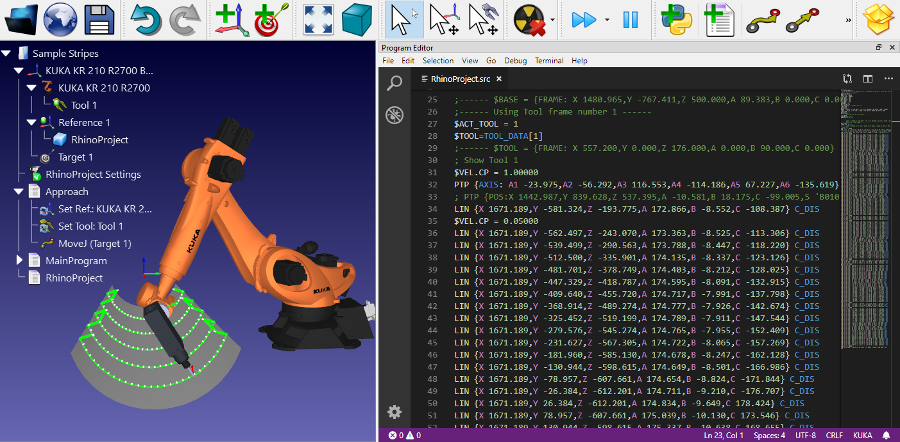
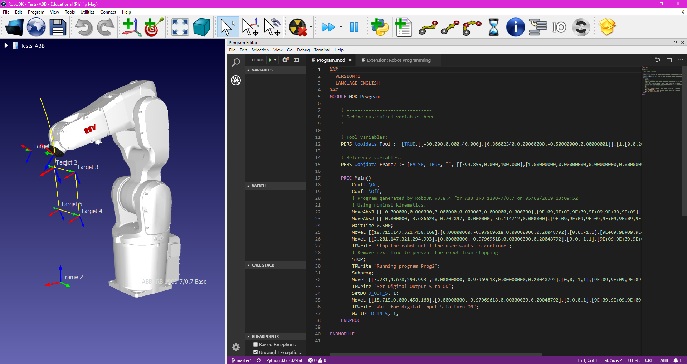
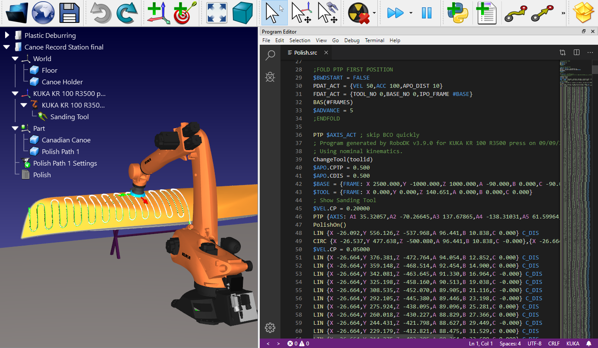
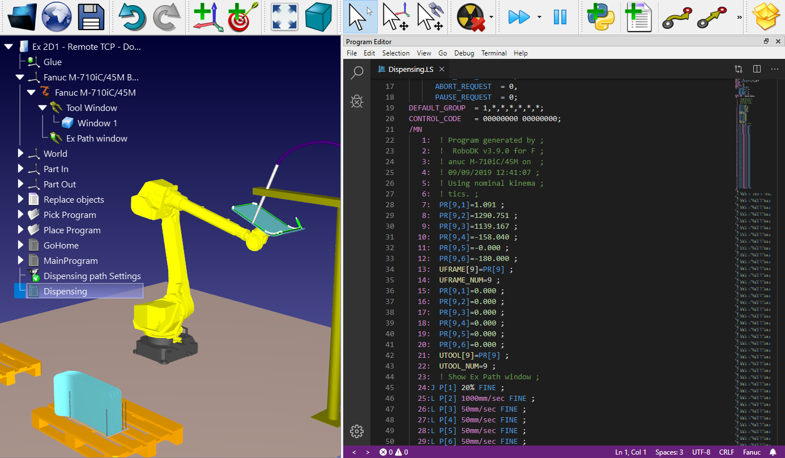
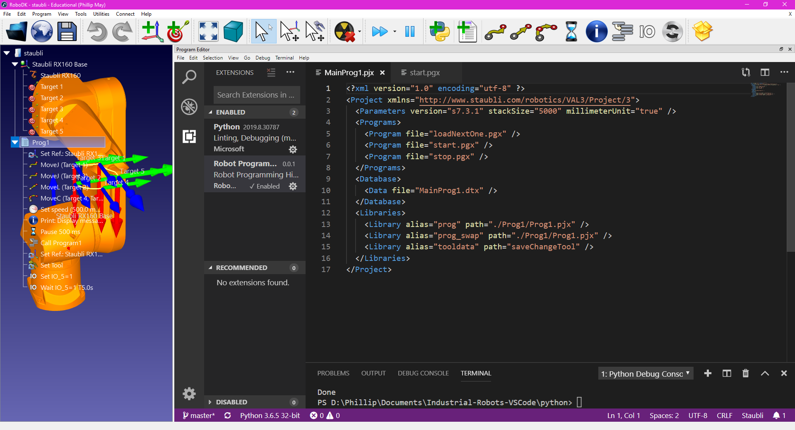
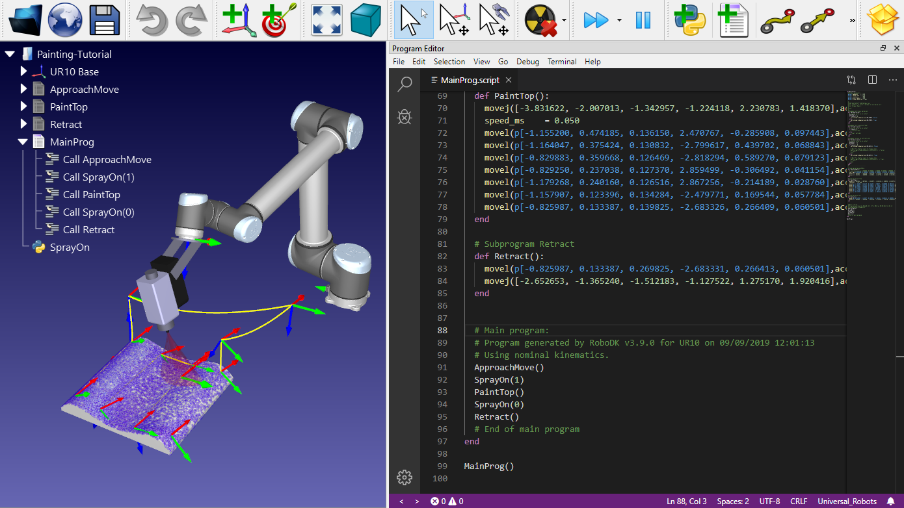

# Industrial Robots extension for VSCode

The Industrial Robots extension for VSCode/VSCodium is an open source extension that aims to provide syntax highlighting for industrial robot programs. This extension aims to support all industrial robot controllers.

If you installed [RoboDK v4.0 for Windows](https://robodk.com/download) or later you should already have this extension installed with VSCodium.

## Features

This extension currently supports the following robots and their corresponding robot controllers and programming languages.
 - ABB (MOD/PRG files)
 - KUKA (SRC/DAT files)
 - Comau (PDL)
 - Motoman (JBI)
 - Fanuc (LS files)
 - Universal Robots (script)
 - Staubli (VAL3/XML)
 - Kawasaki (PRG)

## About RoboDK

This extension is developed and maintained by RoboDK Software. You can simulate and program any industrial robot with RoboDK. 

Useful links:
 - RoboDK Website: https://robodk.com/
 - Robot post processors: https://robodk.com/doc/en/Post-Processors.html
 - RoboDK API: https://github.com/RoboDK/RoboDK-API
 
## Requirements

Installing the extension has no requirements, simply install Industrial Robots from within visual studio like any other add-on.

If you installed RoboDK v3.8.5 or later you should have VSCodium with this extension available. VSCodium is a simplified version of VSCode with almost the same functionality.

# Building and making changes

Each language is described by plain JSON files that you edit directly:

 - `syntaxes/syntax.<id>.json`: the TextMate grammar (comments, strings, numbers, keywords).
 - `cnfg.<id>.json`: the language configuration (comment character, brackets, folding).
 - `package.json`: registers the language id, its aliases and file extensions, and points to the two files above.
 - `snippets/snippet.<id>.json` (optional): code snippets.

To add a new language, copy the files of a similar language, adapt the rules and keywords, and add the `languages` and `grammars` entries to `package.json`.

A few rules of thumb when editing a grammar:
 - Rules are tried in the order listed under `patterns`. When two rules match at the same position the first one wins, so list comments and strings first, and specific patterns (for example `DO[10]`) before plain keyword lists.
 - Use the same scope names as the other grammars (`comment`, `string`, `constant.numeric.c`, `keyword.control`, ...) so that highlighting works with any color theme.
 - The same file extension can belong to several controllers (for example `.prg`). Do not remove an extension from a language to resolve this.

To try your changes, press F5 in VS Code (or run `code --disable-extensions --extensionDevelopmentPath=.` from this folder) and open one of the programs in the `examples` folder.

## Known Issues

No known issues.

-----------------------------------------------------------------------------------------------------------

# Screenshots

ABB IRC5 (MOD/PRG files)

KUKA KRC2 or KUKA KRC4(SRC/DAT files)

Yaskawa Motoman (JBI Inform)

Fanuc (LS files)

Stäubli (VAL3)

Universal Robots (script)

