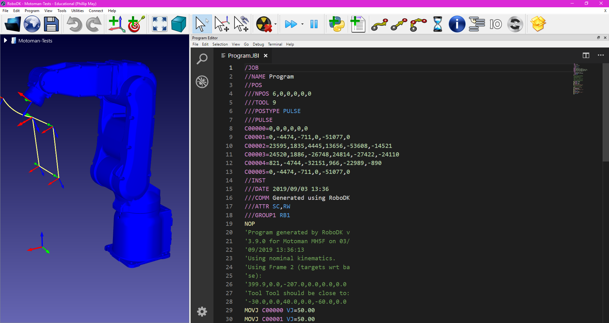

# Industrial Robots extension for VSCode

The Industrial Robots extension for VSCode/VSCodium is an open source extension that aims to provide syntax highlighting for industrial robot programs. This extension aims to support all industrial robot controllers.

If you installed [RoboDK v4.0 for Windows](https://robodk.com/download) or later you should already have this extension installed with VSCodium.

## Features

The extension highlights the programs generated by every RoboDK post processor. It provides syntax highlighting, comment toggling, bracket matching and code folding for the following robot controllers and programming languages.

| Controller / language | File extensions | RoboDK post processors |
|---|---|---|
| ABB RAPID | .mod, .modx, .sys, .sysx, .prg, .pgf | ABB IRC5, OmniCore, S4C, ROKAE |
| Aerotech AeroBasic | .cnc\* | GCode A3200 |
| Allen Bradley Logix5000 (Structured Text) | .txt\* | Allen Bradley Logix5000 |
| Annin Robotics | .ar4 | Annin Robotics |
| Brooks GPL | .gpl, .gpo | Precise, MARS |
| Chaifu | .cfg\* | Chaifu |
| CLOOS Rotrol | .pkt, .txt\* | CLOOS |
| Comau PDL2 | .pdl, .lsv | Comau C5G, Comau Nodal |
| CPC | .cpc | CPC |
| CRP | .r0 | CRP |
| Denso PAC / PacScript | .pac, .pcs | Denso RC7, RC8, RC9, Foxbot |
| Elite Robots EC (JBI) | .jbi\* | Elite Robots EC |
| Epson SPEL+ | .prg | Epson RC |
| Estun | .erp, .erd, .jlt | Estun RCS2, RCS3 |
| Fanuc LS | .ls | Fanuc R-30iA, R-J3 |
| Flexiv | .traj | Flexiv |
| G-code | .cnc, .nc | Generic G-code, B&R, NCP, uArm, KUKA.CNC |
| GSK | .prl | GSK |
| HIWIN HRSS | .hrb | HIWIN |
| Huashu HSR | .prg\* | HUASHU HSR |
| Hyundai | .job, .001-.999\* | Hyundai |
| Inexbot | .jbr | Inexbot, Ligent |
| Inovance | .pts, .pro\* | INOVANCE |
| Kawasaki AS | .pg | Kawasaki, Astorino |
| KEBA KAIRO | .tip, .tid | KEBA KAIRO |
| KUKA KRL | .src, .dat | KUKA KRC1 to KRC5, iiQKA, RSI, CamRob, ArcTech |
| Mecademic | .txt\* | Mecademic |
| Mitsubishi MELFA BASIC / MOVEMASTER | .prg\* | Mitsubishi, Mitsubishi Movemaster EX |
| Nachi / OTC Daihen | .001-.999\* | Nachi AX/FD, OTC |
| NEWKer CNC | .txt\* | NEWKer i6 |
| Omron / Adept V+ | .pg, .vb1, .v2 | Omron, Adept and Stäubli V+ |
| Panasonic G3 | .csr | Panasonic G3 CSR |
| QJAR | .rbg | QJAR |
| Rainbow Robotics | .wsl | Rainbow Robotics |
| Robostar | .job\* | Robostar |
| Siasun | .spf, .txt\* | Siasun, Siasun JOB |
| Siemens Sinumerik | .mpf, .spf\* | Siemens Sinumerik, 840D PKM, MABI |
| Stäubli VAL3 | .pgx, .pjx, .dtx, .ltx | Stäubli VAL3, S6 |
| Techman TMscript | .scpt, .script\* | Techman, Omron TM |
| Toshiba | .txt\* | Toshiba |
| Turin | .txt\* | Turin |
| Universal Robots URScript | .script | Universal Robots, Elite Robots CS |
| Yamaha RCX | .prg\* | Yamaha |
| Yaskawa Motoman INFORM | .jbi, .cnd | Motoman |

\* Several controllers use the same file extension (for example `.prg` or `.txt`). For these files the extension looks at the first lines of the program and selects the matching language automatically. You can always change the language manually from the status bar, and you can turn automatic detection off with the `industrialRobots.detectLanguage` setting.

Post processors that generate Python, Lua, JSON, XML, JavaScript or Java programs use the languages built into VS Code. Unusual extensions of these formats are associated automatically, for example `.drl` (Doosan) and `.jks` (JAKA) as Python, `.aubo` (AUBO) as Lua, and `.kr2` (Kassow) and `.rcp` (Rozum) as JSON.

## About RoboDK

This extension is developed and maintained by RoboDK Software. You can simulate and program any industrial robot with RoboDK. 

Useful links:
 - RoboDK Website: https://robodk.com/
 - Robot post processors: https://robodk.com/doc/en/Post-Processors.html
 - RoboDK API: https://github.com/RoboDK/RoboDK-API
 
## Requirements

Installing the extension has no requirements, simply install Industrial Robots from within visual studio like any other add-on.

If you installed RoboDK v3.8.5 or later you should have VSCodium with this extension available. VSCodium is a simplified version of VSCode with almost the same functionality.

# Building and making changes

Each language is described by plain JSON files that you edit directly:

 - `syntaxes/syntax.<id>.json`: the TextMate grammar (comments, strings, numbers, keywords).
 - `cnfg.<id>.json`: the language configuration (comment character, brackets, folding).
 - `package.json`: registers the language id, its aliases and file extensions, and points to the two files above.
 - `snippets/snippet.<id>.json` (optional): code snippets.

To add a new language, copy the files of a similar language, adapt the rules and keywords, and add the `languages` and `grammars` entries to `package.json`.

A few rules of thumb when editing a grammar:
 - Rules are tried in the order listed under `patterns`. When two rules match at the same position the first one wins, so list comments and strings first, and specific patterns (for example `DO[10]`) before plain keyword lists.
 - Use the same scope names as the other grammars (`comment`, `string`, `constant.numeric.c`, `keyword.control`, ...) so that highlighting works with any color theme.
 - The same file extension can belong to several controllers (for example `.prg`). Do not remove an extension from a language to resolve this.

To try your changes, press F5 in VS Code (or run `code --disable-extensions --extensionDevelopmentPath=.` from this folder) and open one of the programs in the `examples` folder.

## Known Issues

No known issues.

-----------------------------------------------------------------------------------------------------------

# Screenshots

ABB IRC5 (MOD/PRG files)

KUKA KRC2 or KUKA KRC4(SRC/DAT files)

Yaskawa Motoman (JBI Inform)

Fanuc (LS files)

Stäubli (VAL3)

Universal Robots (script)

